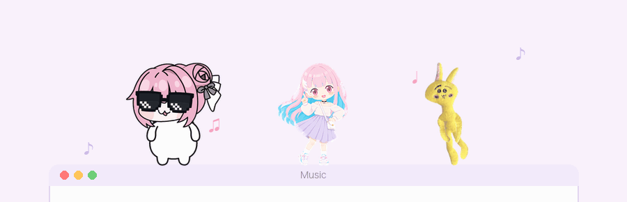
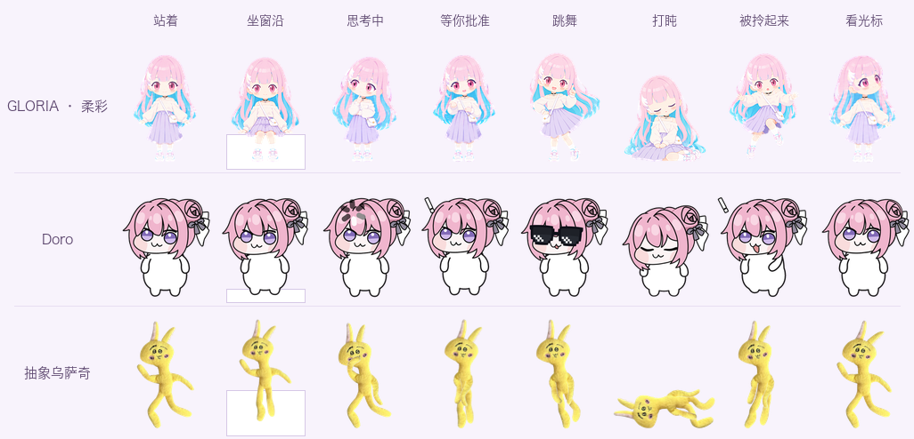
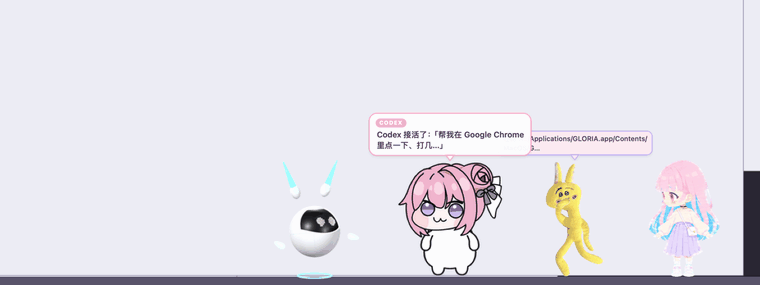
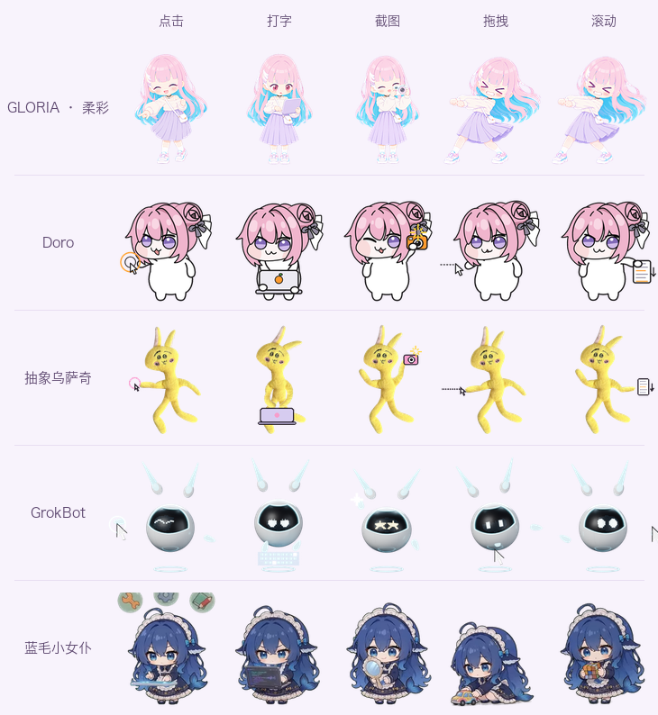
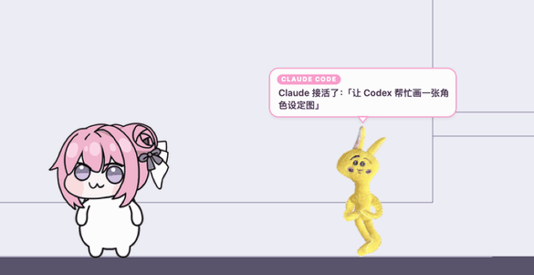

<div align="center">


# GLORIA · Mac 桌宠

**住在窗口上的小伙伴。她们会坐在窗沿上、跟着音乐跳舞，<br>还会把 Claude Code 和 Codex 正在干的活——包括操作你的电脑——演给你看。**

<a href="#安装"></a>


<a href="LICENSE"></a><br>
<a href="#claude-code--codex两个化身互相传话"></a>
<a href="#claude-code--codex两个化身互相传话"></a>
<a href="#computer-use她替-agent-动手"></a>
<a href="#dsh-pet-适配"></a><br>
<a href="https://github.com/seasnakes/gloria-mac-pet/stargazers"></a>
<a href="https://github.com/seasnakes/gloria-mac-pet/commits/main"></a>




</div>

---

## 五个角色，可以同时放出来



| 角色 | 素材 | 做法 |
| --- | --- | --- |
| **GLORIA · 柔彩** | 已验收的 Q 版手绘帧 | 新姿势用同一条 image_gen 流程逐帧画；跳舞、思考和操作电脑的过渡帧是光流推出来的，不叠影，每个像素都来自原画 |
| **Doro** | 本机 DoroPet-macos（基于 [DoroPet](https://github.com/waterfeet/DoroPet_V3)）的站立版 | Live2D 头 + 程序绘制的身体，离屏逐帧渲染；待机带呼吸、轻微摇头和眨眼，操作电脑时拿着欧润吉笔记本和相机 |
| **抽象乌萨奇** | 一张毛绒照片 | Animated Drawings：骨骼绑定 + ARAP 网格，动作来自 BVH 重定向和关节角 |
| **GrokBot** | 作者自己的 Blender 工程（变形短片的完成造型） | 用 Cycles 逐帧渲染：耳朵天线、鳍手、九种 LED 表情、悬浮环和短片里的 3D 光标都是模型本身的部件 |
| **蓝毛小女仆** | [dsh-pet](https://github.com/PC2005-cloud/dsh-pet)（MIT） | 从它的透明动画里截取每个状态的片段，换算到同一套格子，见[下文](#dsh-pet-适配) |

菜单「角色」里勾选谁出场。几个角色站在一起时会互相打招呼，不会叠在同一个位置。

## Computer use：她替 agent 动手



Agent 操作你的电脑时，它的化身会跟着「动手」：

- **走到正在被操作的窗口上**：能站上去就跳到那个窗口顶上；窗口铺满屏幕时，就沿着屏幕底部走到对应位置的旁边。
- **按动作换姿势**：点击时伸手点、打字时抱着小笔记本敲、截图时举相机、拖拽时拽着光标走、滚动时往下划。目标在另一边时，姿势会镜像过去。
- **标出落点**：点到的地方泛起波纹，双击是两圈；截图时窗口闪一下，四角出现取景框；拖拽时画出一条虚线。
- **头顶小字幕**：显示「Google Chrome：点一下」「按 ⌘⇧T」这样的说明。打字只显示字数，不显示内容，所以密码不会出现在气泡里。



能识别的调用：

- **Codex**：`cua_repl` 里的 `getApp` / `click` / `typeText` / `pressKey` / `scroll` / `drag` / `getScreenshot` / `getAXState`。同一个会话后面的调用会沿用前面选中的 App。
- **Claude Code**：computer use 工具（`left_click`、`type`、`key`、`screenshot`、`scroll`、`left_click_drag`…），以及浏览器的 `computer` 工具。

## Claude Code × Codex：两个化身互相传话



在菜单里给 **Claude Code 化身** 和 **Codex 化身** 各挑一个角色，比如乌萨奇当 Claude、Doro 当 Codex：

- **各演各的**：接到任务跳一下，干活时摆思考动作，头顶小字幕显示正在读、改、跑什么。需要你批准时举牌提醒并一直挂着气泡；做完了会说出回复的第一句。
- **互相委托**：Claude 跑 `codex exec "…"` 时，Claude 的化身会走过去，把一个小信封扔给 Codex 的化身。Codex 干活期间，它的化身一直在忙；干完再把信封扔回来。Codex 跑 `claude -p`，或者任一方调用对方的 MCP，也算委托。
- **派出子代理**：身边会跑出一个小分身，子代理结束时挥手消失。

她们只看不动手，不会替你批准任何操作。

## dsh-pet 适配

[dsh-pet](https://github.com/PC2005-cloud/dsh-pet) 是 DeepSeek Harness 里的桌宠，每个动作都是一段 10 秒的透明视频（VP9-alpha `.webm`）。`tools/import_dsh.py` 会把这类宠物转成 GLORIA 的精灵图：

```bash
python3 tools/import_dsh.py <dsh-pet 素材目录> --id <名字> --install
```

- **素材目录**：带 `webm/` 子目录的文件夹，比如 dsh-pet 仓库里的 `dsh-pet/assets`、`$DSH_HOME/dsh-pet/main-animation`，或者自造宠物的 `pet/<种类>-animation`。
- **动作对应**：旁边有 `config.jsonc` 时，按宠物自己的配置取动作：待机、转向、拖拽、点击回应、六档工作状态、睡觉、移动。工作状态映射到 GLORIA 的思考、操作、等批准、完成和出错。
- **转换方式**：每个状态截取一段、抽帧、缩放到同一条脚底线，并清掉视频透明通道里的底噪。
- **装进 App**：`--install` 把结果放进 `~/Library/Application Support/GLORIA/characters/<名字>/`。重开 GLORIA 后，它会出现在「角色」和两个「化身」菜单里。

内置的「蓝毛小女仆」就是这样从 dsh-pet 主角色转来的，原作的 MIT 许可在 `characters/dsh/NOTICE.txt`。

## 她们还会

| | |
| --- | --- |
| 🪟 **坐窗沿** | 坐在窗口顶边，窗口移动就跟着走，窗口关掉就掉下去，被别的窗口挡住会跳上去。在 Dock 和屏幕底部是站着的 |
| 🫳 **拎起来甩** | 揪着后颈拎起来会手脚乱扑腾；松手后按甩的速度飞出去，撞墙会反弹，摔重了还会晕 |
| 🎵 **跟着音乐跳** | 音乐 App 一出声就跳，一拍一个舞步。给了“系统录音”权限就能跟上真实节拍，声音只在内存里分析 |
| 🖱️ **追光标** | 光标在她站的地方晃，她会跑到光标旁边扑一下，不会钻到光标底下挡住点击。连戳 5 下会生气 |
| 🔍 **跟着 Dock 动** | 站在 Dock 上时，放大的图标会把她顶起来；有 App 启动、图标弹跳时，她也跟着蹦 |
| 💤 **打盹** | 3 分钟没碰键盘鼠标就会打盹，一动就醒 |

鼠标只有点在她们身上不透明的地方才会被拦住，别处照常点到下面的窗口。

## 安装

```bash
bash build.sh --install     # 构建并装进 /Applications，然后启动（需要 Xcode 或 Command Line Tools）
```

她们不占 Dock。菜单栏里有一排出场角色的小头像，右键角色本人也能打开同一个菜单。找不到她们时点「叫她们过来」。开机自启在菜单里的「登录时启动」。

<details>
<summary><b>菜单一览</b></summary>

- **角色**：勾选谁出场，可以多选（导入的 dsh-pet 宠物也在这里）
- **Claude Code 化身 / Codex 化身**：接入（装钩子）、由谁来当
- 需要批准时提示音 · 叫她们过来 · 大小 · 自己溜达 · 闲着会打盹 · 追光标 · 登录时启动
- 随音乐跳舞 · 跟着节拍 · 浏览器里的音乐也跳
- **演示**：跳舞 16 秒 / Claude Code 一轮工作 / Claude 请 Codex 帮忙 / Codex 操作电脑 / 被扔出去 / 被拎起来晃一晃 / 打个盹 10 秒

右键某个角色时，菜单只显示她自己，并多一项「让她先休息（隐藏）」。

</details>

<details>
<summary><b>化身钩子会改哪些文件</b></summary>

接入时会改写 `~/.claude/settings.json` 或 `~/.codex/hooks.json`。只增删 GLORIA 自己的条目，其他设置和钩子都保留。改之前会把原文件备份到 `~/Library/Application Support/GLORIA/hook-backups/`；改完后文件会被重新排版，键按字母排序。

钩子命令是 `GLORIA_HUSK=1 '<GLORIA.app>/Contents/MacOS/GLORIA' --hook claude|codex`。它通过私有 Unix 套接字转发精简后的事件，耗时约 10 ms，不输出任何内容；GLORIA 没开时直接退出。computer use 的调用只转发动作和坐标，打的字只转发字数。挪动了 App 之后重新打开一次，钩子会自动指向新位置。Codex 第一次会问要不要信任这些钩子，选信任。

</details>

<details>
<summary><b>命令行与自检</b></summary>

```bash
X=/Applications/GLORIA.app/Contents/MacOS/GLORIA
$X --hooks claude on|off                                  # 同菜单开关
$X --ctl '{"ctl":"status"}'                               # 所有角色的状态（JSON）
$X --ctl '{"ctl":"show","id":"grokbot","on":true}'        # 放出 / 收起角色：gloria / doro / usagi / grokbot / dsh / 导入的名字
$X --ctl '{"ctl":"role","source":"codex","id":"doro"}'    # 指定化身
$X --ctl '{"ctl":"cua"}'                                  # 演示 Codex 操作电脑
$X --ctl '{"ctl":"together"}'                             # 演示 Claude 请 Codex 帮忙
$X --ctl '{"ctl":"dance","seconds":12}'
$X --ctl '{"ctl":"play","anim":"type","pet":"usagi"}'     # 让某个角色做某个动作（tap / type / snap / drag / scroll …）
$X --ctl '{"ctl":"throw","vx":-1200,"vy":1400,"pet":"doro"}'
$X --ctl '{"ctl":"pointer","x":800,"y":90,"seconds":3}'   # 假光标（不动真鼠标），测追光标和 Dock 放大
$X --ctl '{"ctl":"scene","path":"/tmp/s.png","scale":1}'  # 窗口轮廓 + 角色、气泡、信封、点击波纹的真实渲染
$X --ctl '{"ctl":"menu"}'                                 # 打印菜单
```

针对单个角色的命令都可以加 `"pet":"<id>"`；不加时作用于第一个角色。

</details>

<details>
<summary><b>权限与隐私</b></summary>

- 跟随窗口只读窗口位置和所属 App 名，不读窗口内容和标题，不需要屏幕录制权限。
- 跟拍需要“系统录音”权限，不给也能跳，只是不跟拍。App 是临时签名（ad-hoc）构建的，每次重新构建后 macOS 可能会再问一次。
- 不联网，不开网络端口。

</details>

<details>
<summary><b>重新生成角色素材</b></summary>

```bash
python3 tools/gloria_sheet.py                                  # GLORIA：原画 + 平滑思考/舞蹈/操作电脑（需要 OpenCV）
DOROPET=~/Developer/DoroPet-macos $DOROPET_PYTHON characters/doro/render_doropet.py   # Doro（live2d-py + PyQt5）
$ANIMATED_DRAWINGS/.venv/bin/python characters/usagi/ad_usagi.py --build              # 乌萨奇（Animated Drawings）
/Applications/Blender.app/Contents/MacOS/Blender -b <grokbot_transform_v6.blend> --python characters/grokbot/render_grokbot.py
python3 characters/grokbot/pack_grokbot.py                     # GrokBot
python3 tools/import_dsh.py <dsh-pet>/dsh-pet/assets           # 蓝毛小女仆
python3 tools/readme_media.py [截图帧目录]                       # 这份 README 里的图
bash build.sh
```

`DOROPET` 指向本机的 DoroPet-macos 目录（[DoroPet](https://github.com/waterfeet/DoroPet_V3) 的 macOS 版，默认 `~/Developer/DoroPet-macos`）；`ANIMATED_DRAWINGS` 指向 [AnimatedDrawings](https://github.com/facebookresearch/AnimatedDrawings) 的本地副本（默认 `~/Developer/animated-drawings-local`）。只是使用已经生成好的精灵图的话，这些都不需要。

所有角色都用同一套格子：8 列、每格 192×208、脚踩 y=202，第 9–10 行是 16 个看的方向。动作的行号、帧数、每帧时长、锚点和朝向（`facing`）写在各自的 `<id>.json` 里，长动作可以跨行。

</details>

<details>
<summary><b>已知限制</b></summary>

- 委托只认命令行里直接写出的 `codex` / `claude` 调用。套在脚本里间接调用的认不出来。
- Codex 的 computer use 坐标按窗口内的坐标换算到屏幕上。窗口截图被缩放过时，落点会有偏差。Claude Code 的桌面点击会在真实光标停下的地方泛起波纹。
- dsh-pet 只转换 `.webm`。只有 `.mov` 素材的宠物要先转成 webm。
- Claude/Codex 工作或等批准时，她们站着演，不坐也不睡。
- Dock 放大的抬升是按放大曲线估算的，不读取 Dock 里真实的图标位置（那需要辅助功能权限）。
- 窗口顶边离菜单栏太近时放不下她们，这时她们会站在屏幕底部。
- 多显示器按逻辑支持，只在一台外接屏上试过。

</details>

## 素材与许可

代码（`Sources/`、`tools/`、各角色的生成脚本）以 [MIT](LICENSE) 授权。角色美术不在 MIT 范围内，各自的来源如下：

| 角色 | 来源 | 说明 |
| --- | --- | --- |
| GLORIA · 柔彩 | 作者的原创角色 | 精灵图保留所有权利 |
| Doro | [DoroPet](https://github.com/waterfeet/DoroPet_V3)（Apache-2.0）自带的 Live2D Doro 模型，离屏渲染成帧 | Doro 是网络同人形象；本仓库只含渲染出的图，不含模型文件 |
| 抽象乌萨奇 | 一张乌萨奇（《ちいかわ》，©ナガノ）毛绒玩偶的照片 | 同人二创，仅供个人非商业使用 |
| GrokBot | 作者的 Blender 工程 | 机身上的标志是 xAI 的 Grok 标志 |
| 蓝毛小女仆 | [dsh-pet](https://github.com/PC2005-cloud/dsh-pet) 的透明动画 | MIT，原许可见 `characters/dsh/NOTICE.txt` |

## Star History

<a href="https://star-history.com/#seasnakes/gloria-mac-pet&Date">
  <picture>
    <source media="(prefers-color-scheme: dark)" srcset="https://api.star-history.com/svg?repos=seasnakes/gloria-mac-pet&type=Date&theme=dark">
    
  </picture>
</a>

---

<sub>灵感来自 <a href="https://github.com/lachydotmcg/capri-desktop">Capri</a>，没有使用它的代码或美术。各角色素材的来源见<a href="#素材与许可">素材与许可</a>。</sub>
